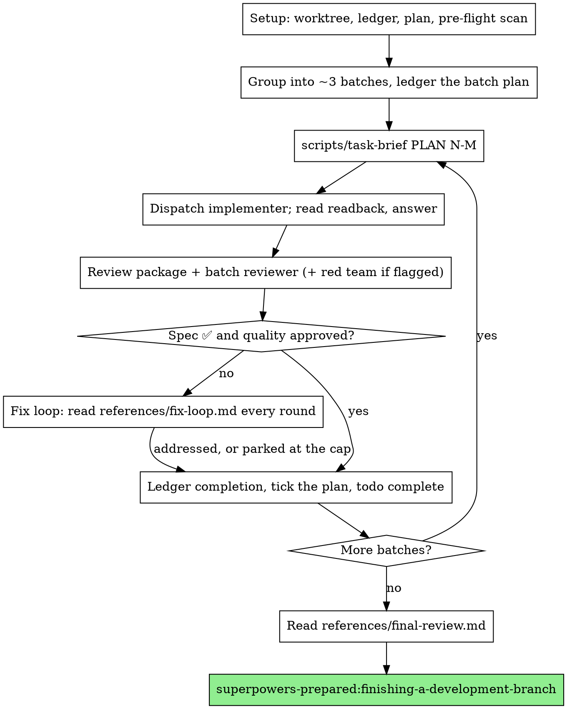

# Subagent-Driven Development

<!-- [fork] --> **Rito mode:** if the request that invoked this skill has a line starting with `@@RITO:`, read `rito.md` in this skill's directory before anything else and follow it: it replaces this skill's normal flow and says which parts of this file still apply. Without that line, ignore this paragraph.

Execute plan by grouping its tasks into a few cohesive batches, dispatching a fresh implementer subagent per batch, a review (spec compliance + code quality) after each, strict review gates and a broad whole-branch review at the end.

## Required Start

Announce: `I'm using subagent-driven-development to execute this plan.`

**Why subagents:** You delegate tasks to specialized agents with isolated context. By precisely crafting their instructions and context, you ensure they stay focused and succeed at their task. They should never inherit your session's context or history — you construct exactly what they need. This also preserves your own context for coordination work.

**Core principle:** Fresh subagent per cohesive *batch* of tasks + review per batch (spec + quality) + broad final review = high quality, fast iteration

The unit of dispatch is the batch, never the individual task — see [references/batching.md](references/batching.md). One subagent per task is measurably the slowest, costliest, and lowest-quality way to run a plan.

**Narration:** between tool calls, narrate at most one short line — the
ledger and the tool results carry the record.

**Continuous execution:** Do not pause to check in with your human partner between tasks. Execute all tasks from the plan without stopping. The only reasons to stop are the four named below, or all tasks complete. "Should I continue?" prompts and progress summaries waste their time — they asked you to execute the plan, so execute it.

**Rulings, not stalls.** A running plan does not wait on a human. Conflicts,
ambiguities, plan defects, a cap you would have asked to exceed — decide
them. The spec is the binding authority, the plan is its argument, and your
judgment settles what neither answers. Record every decision in the ledger as
`Ruling: <what you decided> — <why> — <what it costs if wrong>`, and keep
going. A wrong ruling costs rework your human partner can see and undo; a
session parked on a question costs their whole day and buys nothing.

Four things stop you, and only these: an irreversible or destructive
operation; a security-sensitive action; a side effect outside this worktree
that norms say you ask about first (a merge, a push to a shared branch, a
publish); and a plan so broken that every path forward is a guess. For those,
stop and ask.

**Read the reference at the step that names it, every time.** <!-- [fork] -->
After a compaction this file comes back truncated and your memory of a
reference does not come back at all; the files in `references/` are read
fresh from disk.

**This skill or inline?** If the choice between this skill and
superpowers-prepared:executing-plans is still open, read
[references/when-to-use.md](references/when-to-use.md).

## The Process

## Setup

Ensure the work happens in an isolated workspace: use
superpowers-prepared:using-git-worktrees to create one or verify the existing one.
Never start implementation on a main/master branch without your human
partner's explicit consent.

Conversation memory does not survive compaction. In real sessions,
controllers that lost their place have re-dispatched entire completed task
sequences — the single most expensive failure observed. Track progress in
a ledger file, not only in todos.

- Each plan owns a workspace: at skill start, run this skill's
  `bash scripts/sdd-workspace PLAN_FILE` — it prints the plan's git-ignored
  directory (under `<repo-root>/.superpowers/sdd/`), home to
  every artifact for THIS plan: ledger, briefs, reports, review packages.
  Another plan's directory is never yours to read or write.
- Check for this plan's ledger at `<workspace>/progress.md`. If its first
  line names your plan file, batches with a `Batch <B>: complete` line are
  DONE — do not re-dispatch them; resume at the first batch without one, and
  re-read the recorded batch plan rather than re-deriving the grouping. A
  batch whose last line is a fix round is mid-loop: read
  [references/fix-loop.md](references/fix-loop.md) and resume at the next
  round. A ledger whose first line names a different plan file — or a stray
  ledger at the old flat path `.superpowers/sdd/progress.md` — is another
  plan's progress: leave it in place and start your own, fresh.
- Create the ledger with its identity as the first line:
  `# SDD ledger — plan: <plan file path>`.
- The ledger is your recovery map: the commits it names exist in git even
  when your context no longer remembers creating them. After compaction,
  trust the ledger and `git log` over your own recollection.
- `git clean -fdx` will destroy the workspace (it's git-ignored scratch); if
  that happens, recover from `git log`.

Read the plan once and note its context and Global Constraints. Then read
[references/batching.md](references/batching.md), group the tasks into
batches, write the batch plan to the ledger, and create **one todo per
batch** — not one per task. The todo granularity is what keeps the ledger,
the checkboxes, and the dispatches in agreement. Track individual tasks as
the plan's own checkboxes, which you tick as each batch reports. Batches
that share no files and no sequential dependency run as one wave: read
[references/parallel-waves.md](references/parallel-waves.md).

If the plan names a Spec, read that too: the spec is the
authority the plan argues from, and conflicts inside the plan resolve
against it. A plan with no reachable spec gets a ledger note saying so —
rulings made without one are provisional.

Before dispatching the first batch, read
[references/preflight.md](references/preflight.md) and run the conflict scan
it describes. Its table and rulings go in the ledger.

## Use the project harness

Use the project harness to give the subagents context and structure. Before the first dispatch, read [references/harness-integration.md](references/harness-integration.md): `extract-boundary` per batch, the harness check each implementer runs, learned patterns in the prompts, and verify-all before the final review.
Frontend/UI work gets `frontend-design`; React/Next.js work gets `vercel-react-best-practices` (or the current framework's equivalent); new libraries or versions get `context7`, when available.

<!-- [fork] -->
**Prefer the project's own agents, skills, and playbooks.** Before each
dispatch, check what the project or workspace defines (`.claude/agents/`,
the harness's agents, skills, and playbooks) and the task's **Follow** line.
When an agent's description fits the batch's work, dispatch that agent
instead of `general-purpose`, still with the implementer prompt as its
instructions; name the matching project skills under "Suggested skills".
Use `general-purpose` only when nothing the project defines fits. The same
applies to reviewers: a project review agent that fits outranks the generic
one.

**Context isolation.** Never forward parent session context or history to
subagents. Each prompt is built from scratch: the brief path, the file paths
it needs, the binding constraints, and the types and signatures
`extract-boundary` gave you — never prior analysis, failed hypotheses, or
another subagent's output. That is also what keeps every subagent on the
shared cached prefix.

**Skills in subagents.** The prompt templates carry the focused-subagent
instruction (no superpowers-prepared *process* skills; project skills and
`frontend-design` / `vercel-react-best-practices` are allowed), and
`hooks/subagent-guard.js` enforces it. Name the skills the work calls for in
the brief's **Suggested skills** line. Before you change that instruction or
the guard, read [references/skill-leakage.md](references/skill-leakage.md).

**Background services.** A batch whose work starts servers, databases, or
queues gets the cleanup instructions in
[references/e2e-hygiene.md](references/e2e-hygiene.md).

## Model Selection

Use the least powerful model that can handle each role, and **always
specify the model explicitly** — an omitted model inherits your session's,
often the most expensive. The final whole-branch review and fix-loop round 3
take a more capable tier; mechanical work takes the cheapest. The tiers per
role and why turn count beats token price are in
[references/model-selection.md](references/model-selection.md).

## The Task Loop

Everything below describes the cycle for **one batch**. Where it says
"the task", read "the batch" — the batch is what gets a brief, an
implementer, a review, a fix loop, and a ledger line. A batch of one task
is the ordinary case for the exceptions in references/batching.md.

Everything you paste into a dispatch prompt — and everything a subagent
prints back — stays resident in your context for the rest of the session
and is re-read on every later turn. Hand artifacts over as files.

**Waiting on dispatched subagents:** never poll with short timeouts, and
never sit in one silent, open-ended wait. Keep doing local work; when idle,
wait in bounded stretches (five to ten minutes), and between them post one
line of status and chase any child that finished without reporting.

### 1. Dispatch the implementer

Record BASE (`git rev-parse HEAD`) before dispatching — the review package
and fix-round diffs need it.

- **Batch brief:** before dispatching an implementer, run this skill's
  `bash scripts/task-brief PLAN_FILE TASKS` — where `TASKS` is the batch's range
  (`1-6`), an explicit list (`2,5,9`), or a bare number for a task that
  genuinely earns its own dispatch. It extracts every task's full text into
  one uniquely named file and reports it as
  `wrote <path>: <n> lines, <n> task(s)` — take the path out of that line;
  do not capture the whole sentence into a variable and paste it. Your
  dispatch should contain: (1) one line on where this batch fits in the
  project, and one line on why these tasks are one batch; (2) the brief
  path, introduced as "read this first — it is your requirements, with the
  exact values to use verbatim"; (3) interfaces and decisions from earlier
  batches that the brief cannot know; (4) your resolution of any ambiguity
  you noticed in the brief; (5) the report-file path and report contract;
  (6) a **Suggested skills** line, or "none". Exact values appear only in
  the brief. Never make a subagent read the whole plan file, and never
  paste the brief's text into the dispatch.
- **Report file:** name the implementer's report file after the brief
  (brief `…/batch-1-6-brief.md` → report `…/batch-1-6-report.md`) and put
  it in the dispatch prompt. The implementer writes the full report there
  and returns only the receipt: contract, status, files changed, files in
  the contract it did NOT change, commands run, commits, a one-line test
  summary, one paragraph of evidence, concerns, and the report file path.
- A dispatch prompt describes one batch, not the session's history. Do not
  paste accumulated prior summaries ("state after Batch 1") into later
  dispatches — a real session's dispatch hit 42k chars of which 99% was
  pasted history.
- The implementer never dispatches subagents — not helpers, and never a
  reviewer (the template carries that contract). Review arrives from you,
  after the report.
- If an earlier batch parked a finding in the area this batch touches, carry
  a pointer to that ledger entry in the dispatch.
- Record the implementer's agent identity from the dispatch result —
  fix-loop rounds 1-2 resume this agent.
- The implementer's first return is the contract readback, not a report.
  Read it before you resume the implementer. If the rewritten invariants
  diverge from the brief, or "What I do NOT know" lists a load-bearing
  assumption, answer first. A readback you did not read never happened —
  and reading it is cheap: twenty lines against a whole batch redone. <!-- [fork] -->
- Never dispatch multiple implementation subagents in parallel unless they
  form a file-disjoint wave (references/parallel-waves.md) — overlapping
  batches conflict.

Template: [implementer-prompt.md](implementer-prompt.md)

### 2. Handle the report

**DONE:** Generate the review package (`bash scripts/review-package PLAN_FILE BASE HEAD`, from this skill's directory — it reports `wrote <path>: <n> commit(s), <n> bytes` — take the path from that line; BASE is the commit you recorded before dispatching the implementer — never `HEAD~1`, which silently drops all but the last commit of a multi-commit batch), then dispatch the batch reviewer with the printed path.

**Any other status** (DONE_WITH_CONCERNS, NEEDS_CONTEXT, BLOCKED): read
[references/handling-reports.md](references/handling-reports.md) and follow
it, every time you get one.

If the implementer asks questions — before starting or mid-task — answer
clearly and completely, provide additional context if needed, and don't
rush it into implementation.

### 3. Review the batch

Per-batch reviews are batch-scoped gates. The broad review happens once, at the
final whole-branch review. Never skip the batch review, and never accept a
report missing either verdict — spec compliance AND task quality are both
required. Implementer self-review never replaces the batch review.

- Hand the reviewer its diff as a file: the path `scripts/review-package`
  printed (or, without bash: `git log --oneline`, `git diff --stat`, and
  `git diff -U10` for the range, redirected to one uniquely named file).
  Use the BASE you recorded before dispatching the implementer. Never
  dispatch a batch reviewer without a diff file.
- **Reviewer inputs:** the batch reviewer gets four paths — the same brief
  file, the report file, the review package, and the findings file it must
  write its report to (`…-brief.md` → `…-review-1.md`) — plus the global
  constraints that bind the batch. The findings path is not optional: the
  fix round and the re-review both read it, and a reviewer without one
  returns its whole report through your context instead.
- The global-constraints block you hand the reviewer is its attention
  lens. Copy the binding requirements verbatim from the plan's Global
  Constraints section or the spec: exact values, exact formats, and the
  stated relationships between components ("same layout as X", "matches
  Y"). The reviewer's template already carries the process rules.
- Do not add open-ended directives like "check all uses" without a
  concrete, task-specific reason, and do not ask a reviewer to re-run tests
  the implementer already ran on the same code.
- Do not pre-judge findings for the reviewer — never instruct a reviewer to
  ignore or not flag a specific issue. If the prompt you are writing
  contains "do not flag," "don't treat X as a defect," "at most Minor," or
  "the plan chose" — stop: you are pre-judging, usually to spare yourself a
  review loop.

<!-- [fork] --> **Red team:** when any task in the batch carries `Risk
flags` other than `none`, read [references/red-team.md](references/red-team.md)
and dispatch `superpowers-prepared:red-team` in parallel with the batch
reviewer, on the same package, with the focus categories it lists for the flag.

If the reviewer reports "⚠️ Cannot verify from diff" items, read
[references/cannot-verify.md](references/cannot-verify.md) before you mark
the batch complete.

Template: [task-reviewer-prompt.md](task-reviewer-prompt.md)

### 4. The fix loop

The loop triggers when the review reports spec ❌, any Critical or Important
finding (the red team's Critical/High included), or a ⚠️ item you confirmed
as a real gap.

When it triggers, read [references/fix-loop.md](references/fix-loop.md) and
follow it. Read it again before every round, even if you read it earlier in
this session: it holds the three-round cap, the breaker, and the ledger line
each round writes, and your memory of it does not survive compaction.
Never fix findings yourself in the controller session.

### 5. Complete the batch

When the review comes back clean — or every open finding is parked with a
ruling at the cap — append the completion line to the ledger in the same
message as your other bookkeeping:

- `Batch <B> (Tasks <N>-<M>): complete (commits <base7>..<head7>, review clean)`
- `Batch <B> (Tasks <N>-<M>): complete (commits <base7>..<head7>, <K> parked)`
  after a tripped breaker

Then mark the batch's todo complete and move on. Never move to the next
batch while the review has open Critical/Important issues that are neither
fixed nor parked-with-ruling at the cap.

Also flip the checkbox of **every task the batch covered** in the plan file
from `- [ ]` to `- [x]`, and if a `state.md` with a plan status section
exists, update it too — the ledger is your recovery map, the plan file is
what your human partner reads.

## Final Review

When every batch is complete, read
[references/final-review.md](references/final-review.md) and follow it. It
covers the whole-branch review and its inputs, its single fix wave, the
"Rulings I made" list, and how you finish.

## Common Rationalizations

| Excuse | Reality |
|--------|---------|
| "Close enough on spec compliance" | Reviewer found spec gaps = not done. Fix or hit the cap and adjudicate — those are the only exits. |
| "I'll fix it myself, dispatching is overhead" | Controller fixes pollute your context and skip review. Resume the implementer. |
| "One more round will converge" | Past the cap, rounds don't converge — the failure is structural. Adjudicate and route. |
| "I remember the fix loop, no need to re-read it" | You remember a summary, and after a compaction not even that. Read references/fix-loop.md before the round. |
| "This finding is obviously wrong, I'll drop it" | You adjudicate only at the cap, and every ruling is a ledger entry. Silent discards are forbidden. |
| "The fix was small, skip the re-review" | Unreviewed fixes are how regressions land. Every round ends with a scoped re-review. |
| "Ledger bookkeeping is overhead" | The ledger is what survives compaction. Controllers without one have re-dispatched entire completed task sequences. |
