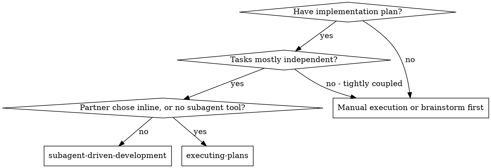

# When to Use, and How It Differs From Inline Execution

Part of superpowers-prepared:subagent-driven-development. Read it when the
choice between this skill and executing-plans is still open.

**vs. Executing Plans (inline):**
- Fresh subagent per batch of tasks (no context pollution) instead of one
  context carrying every task to the end
- Review after each batch (spec compliance + code quality) instead of only at
  the end, so a defect is caught while its batch is still the subject
- Costs a fresh context per batch and per review; inline costs one context plus
  one final reviewer. Batching is what keeps that difference small — per-task
  dispatch is what makes it large
- Both run in this session, share the same plan workspace and ledger, and never
  pause between units of work. A plan can even change executors mid-flight: the
  ledger on disk is what the next one resumes from
